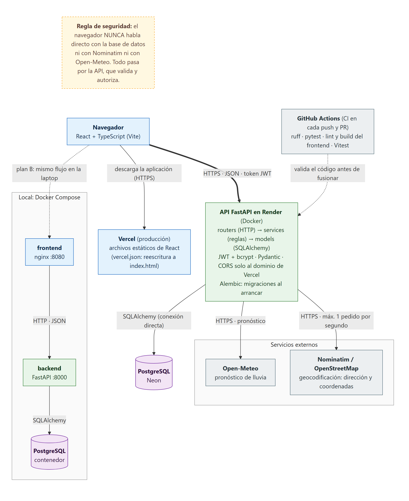
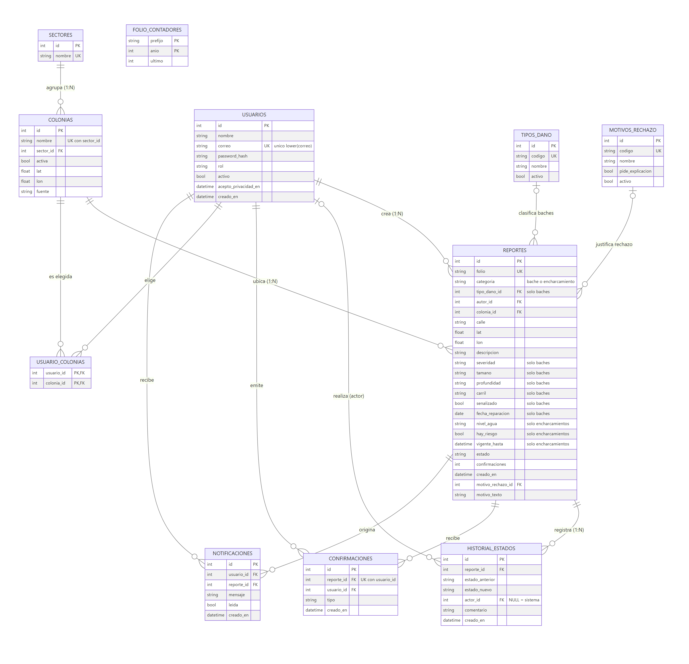
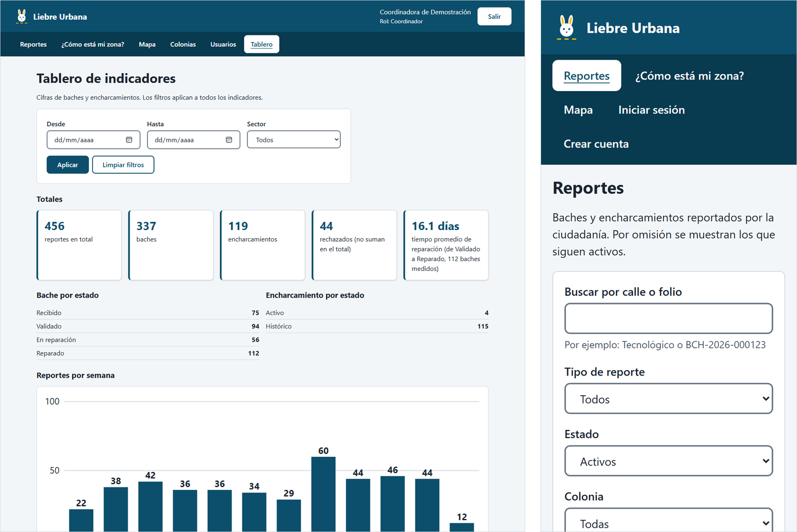

<!-- portada
titulo: Liebre Urbana: plataforma ciudadana de baches y encharcamientos de Ciudad Juárez
integrante: Luis David Reyna Morisco · 22111443 | Rol: base de datos, backend (cuentas, roles, geocodificación y reportes del ciudadano), frontend base y pantallas de reporte, Docker, CI y despliegue
integrante: Carlos Limones Ayala · 22111415 | Rol: consulta pública, zona, detalle, moderación, administración, tablero y aviso de lluvia (de punta a punta); accesibilidad y pruebas del frontend
enlace: Repositorio | https://github.com/luisreyna060318-alt/liebres-urbanas
enlace: Aplicación en línea | https://liebre-urbana.vercel.app
enlace: API y documentación | https://liebre-urbana-api.onrender.com/docs
fecha: Ciudad Juárez, Chihuahua, México a 26 de noviembre de 2026
-->

<!-- solo-md -->
# Liebre Urbana: reporte técnico

Fuente del reporte técnico. El documento que se entrega es `docs/REPORTE.pdf` (y `docs/REPORTE.docx`), generado con
`python docs/reporte/generar_docx.py` y `docs/reporte/convertir_pdf.ps1`. Lo marcado como **[PENDIENTE: …]** falta por
completar o por confirmar antes de la entrega.
<!-- /solo-md -->

## 1. Fundamentación

### 1.1 Problema

En Ciudad Juárez los vecinos reportan baches por redes sociales y aplicaciones de mensajería. Esos reportes se pierden entre otras
publicaciones, se repiten y casi nunca se sabe si alguien los atendió. Con las lluvias pasa algo parecido: algunas calles se inundan
y los conductores se enteran hasta que llegan al charco. La asociación civil "Calles Seguras Juárez" (cliente ficticio de la
materia) nos pidió una plataforma para **reportar, consultar por zona y dar seguimiento** a baches y encharcamientos, con cifras que
su mesa directiva pueda presentar a la autoridad.

### 1.2 Usuarios y contexto

La plataforma tiene un visitante sin cuenta y tres roles (Tabla 1). Es un proyecto escolar de dos personas con unas 40 horas reales
de trabajo (del martes 24 por la noche al jueves 26 a las 17:00). La materia exige React, FastAPI y PostgreSQL, al menos un servicio
externo consumido desde el backend, Docker Compose, despliegue público y PRs revisados. Por el tamaño del equipo, el alcance se
dividió en niveles (P0, P1 y P2) desde el primer día. Los datos de demostración son ficticios, salvo el catálogo de colonias.

<!-- tabla: anchos=2600,6238 -->
| Rol | Qué hace en la plataforma |
|---|---|
| Visitante (sin cuenta) | Consulta los reportes activos, busca por calle o folio, revisa "¿Cómo está mi zona?" y ve el aviso de lluvia |
| Ciudadano | Reporta baches y encharcamientos, confirma o desmiente reportes de otras personas y corrige los suyos mientras están en Recibido |
| Moderador (voluntario) | Valida o rechaza los reportes nuevos y registra el avance de una reparación |
| Coordinador (mesa directiva) | Administra colonias, sectores y usuarios, registra avances de reparación y consulta el tablero de indicadores |

Tabla 1. Roles de la plataforma. Fuente: `docs/plan/BACKLOG.md`.

### 1.3 Productos similares

Revisamos dos productos conocidos como referencia de ideas (Tabla 2). No hicimos un análisis a fondo de ellos ni de los canales del
municipio de Juárez (teléfono, redes sociales o formularios).

<!-- tabla: anchos=1700,3400,3738 -->
| Producto | Qué es | Idea que tomamos |
|---|---|---|
| FixMyStreet (mySociety, s. f.) | Plataforma de reporte ciudadano: el vecino marca un problema en el mapa y se envía a la autoridad responsable | Reporte con ubicación, folio y estado visible para todos |
| Waze (s. f.) | Aplicación de navegación con reportes de la comunidad sobre incidentes en el camino | Confirmar o desmentir lo que reportó otra persona |

Tabla 2. Productos similares que usamos como referencia.

Lo que Liebre Urbana agrega para el caso de la asociación: detección de duplicados por distancia (30 m para baches y 50 m para
encharcamientos), vigencia automática de los encharcamientos (6 h que se renuevan con cada confirmación), moderación por voluntarios
con un historial que no se puede borrar y un aviso de lluvia que lleva a la consulta por zona.

### 1.4 Alcance

El backlog tiene 34 historias de usuario en 8 épicas y 9 requerimientos no funcionales (pantallas desde 360 px, WCAG 2.2 AA, URL
pública, arranque en menos de 3 minutos, contraseñas protegidas, consulta en menos de 3 s con 500 reportes, pruebas automatizadas,
español de México y datos de demostración). La Tabla 3 resume qué entró en cada nivel.

<!-- tabla: anchos=2000,4338,2500 -->
| Nivel | Qué incluye | Estado al 25-nov, 21:50 |
|---|---|---|
| P0 (se entrega sí o sí) | 20 historias indispensables y los requisitos de la materia | Las 20 en `main`; 16 cumplen todos sus criterios y 4 tienen uno pendiente |
| P1 (si P0 está desplegado) | 8 historias deseables: mapa, exportar CSV y XML, colonias de interés, puntos recurrentes, resumen por colonia, catálogos, avisos y encharcamientos sin recargar | No iniciadas (`/mapa` y `/perfil` son pantallas provisionales) |
| P2 (trabajo futuro) | 6 historias: fotos, trayecto, fusionar duplicados, cuadrillas, enlace municipal y PWA | Fuera del alcance (sección 4.5) |

Tabla 3. Alcance por nivel. Fuente: `docs/plan/BACKLOG.md` y PRs fusionados.

## 2. Planeación

### 2.1 Historias de usuario y tablero

El backlog completo está en [`docs/plan/BACKLOG.md`](https://github.com/luisreyna060318-alt/liebres-urbanas/blob/main/docs/plan/BACKLOG.md):
cada historia tiene su ID (HU-xx.x), prioridad del cliente, nivel, responsable, PR y la forma de cumplir sus criterios de aceptación.
La Tabla 4 resume el estado por épica.

<!-- tabla: anchos=2500,1600,1250,1000,1000,1488 -->
| Épica | Historias | P0 completas | P1 | P2 | PRs |
|---|---|---|---|---|---|
| E1. Cuentas y acceso | HU-01.1 a 01.4 | 3 de 3 | 1 | — | #1, #2, #12 |
| E2. Reporte de baches | HU-02.1 a 02.5 | 4 de 4 | — | 1 | #4, #5, #7 a #10 |
| E3. Reporte de encharcamientos | HU-03.1 a 03.4 | 1 de 3 | 1 | — | #6, #11 |
| E4. Consulta ciudadana | HU-04.1 a 04.6 | 3 de 4 | 1 | 1 | #19, #22, #30 |
| E5. Validación y seguimiento | HU-05.1 a 05.5 | 2 de 2 | — | 3 | #24, #25 |
| E6. Administración | HU-06.1 a 06.3 | 2 de 2 | 1 | — | #20, #21 |
| E7. Indicadores | HU-07.1 a 07.3 | 0 de 1 | 2 | — | #26 |
| E8. Avisos | HU-08.1 a 08.4 | 1 de 1 | 2 | 1 | #18 |
| **Total** | **34** | **16 de 20** | **8** | **6** | |

Tabla 4. Historias por épica (P1 sin iniciar; P2 es trabajo futuro). Fuente: `BACKLOG.md` y `gh pr list`, 25-nov-2026.

**Backlog en issues, sin tablero.** El 25 de noviembre registramos el backlog en GitHub Issues: la propuesta (#36), las 34
historias con sus criterios (#38 a #71) y las tareas transversales (#72 a #80). Se registraron al final y no durante el trabajo. Al
auditar cada criterio antes de cerrar, 16 historias indispensables quedaron cerradas como completas y 4 siguen abiertas porque un
criterio no se observa desde la interfaz: #48 y #49 (se corrigen en #81), #51 y #65. No se creó un tablero de GitHub Projects;
durante el trabajo el seguimiento se hizo con la columna PR de `BACKLOG.md`, la descripción de cada PR y la lista de PRs.

### 2.2 Cronograma real

El plan ([`PLAN_DE_TRABAJO.md`](https://github.com/luisreyna060318-alt/liebres-urbanas/blob/main/docs/plan/PLAN_DE_TRABAJO.md),
sección 4) tenía puntos de control G0 a G5. La Tabla 5 compara el plan con lo que registran Git y GitHub (hora de Ciudad Juárez,
UTC−7).

<!-- tabla: anchos=2300,4638,1900 -->
| Cuándo | Qué pasó | Plan |
|---|---|---|
| Mar 24, 23:25 | Primer commit en `main`: plan, contrato de la API y archivos base | G0 |
| Mar 24, 23:51 a Mié 25, 00:26 | Luis, con el orquestador y agentes de apoyo, abre los PRs #1 a #14 (backend, frontend, infraestructura, diagramas y documentos) | Noche del 24 |
| Mié 25, 10:56 a 10:57 | Carlos revisa y aprueba #1 a #14 y se fusionan | G1 (08:15 a 10:30) |
| Mié 25, 11:25 a 12:08 | Se abren #16 y #17 (colonias y semilla) y Carlos abre #18 a #26 | — |
| Mié 25, 15:03 a 15:20 | Se abren #27 (accesibilidad), #28 (bitácora de Carlos) y #29 (despliegue) | — |
| Mié 25, tarde | Despliegue en Neon, Render y Vercel; se comprueban salud, `/docs` y CORS (#29) | G2 (13:00) |
| Mié 25, 15:08 a 15:55 | Luis revisa y se fusionan #16 a #27 y #30; con #30 las 20 historias P0 quedan en `main` | G3 (20:00) |
| Mié 25, 15:46 a 16:10 | Se abren #31 (este reporte) y #32 a #34 (arreglos de la revisión) | — |
| Mié 25, 20:12 a 20:13 | Luis aprueba y se fusionan #34, #33, #32 y #28 | — |
| Mié 25, 20:55 a 21:15 | Se fusiona #29; búsqueda de secretos en el historial y arranque cronometrado desde un clon limpio | — |
| Mié 25, 21:15 a 21:50 | Se fusiona #35, se auditan los criterios, se registran los issues y se abre #81 | — |
| [PENDIENTE: fecha] | Congelamiento de código y etiqueta `v1.0.0` | G4 y G5 |

Tabla 5. Plan frente a lo registrado. Fuente: `PLAN_DE_TRABAJO.md`, `git log` y `gh pr list`.

La revisión de la mañana terminó casi media hora después de lo previsto y el despliegue de humo se movió de las 13:00 a la tarde.
En cambio, el código de las 20 historias P0 llegó a `main` antes de las 20:00 planeadas, aunque la auditoría posterior
encontró 4 con un criterio pendiente. Las historias P1 no se iniciaron.

### 2.3 Arquitectura



Figura 1. Arquitectura de Liebre Urbana. Fuente: `docs/arquitectura.png`.

El navegador descarga la aplicación React desde Vercel y solo habla con la API de FastAPI (en Render, dentro de un contenedor Docker)
por HTTPS y JSON. La API es la única que habla con PostgreSQL (Neon) y con los dos servicios externos: Nominatim de OpenStreetMap
(dirección ↔ coordenadas) y Open-Meteo (probabilidad de lluvia). Así la validación y la autorización ocurren en un solo lugar
(Fielding, 2000). Con Docker Compose las mismas tres piezas corren en una laptop.

### 2.4 Justificación del stack

<!-- tabla: anchos=1900,2500,4438 -->
| Pieza | Elección | Por qué |
|---|---|---|
| Interfaz | React 19 + TypeScript + Vite | La exige la materia; componentes con props y hooks (React, s. f.); los tipos evitan errores entre pantallas y API |
| API | FastAPI + Pydantic v2 | Validación de entrada y salida con esquemas y documentación OpenAPI en `/docs` sin trabajo extra (FastAPI, s. f.) |
| Datos | PostgreSQL + SQLAlchemy 2 + Alembic | Restricciones, llaves foráneas y triggers en la base (PostgreSQL Global Development Group, s. f.); migraciones reproducibles (Alembic, s. f.; SQLAlchemy, s. f.) |
| Contraseñas y sesión | `bcrypt` y JWT con PyJWT | Hash con sal y token firmado; se evitaron bibliotecas sin mantenimiento (OWASP Foundation, 2025) |
| Estado en el cliente | `useState`, `useEffect` y el hook propio `useApi` | Lo que enseña la unidad 3, sin librerías de estado extra; la única dependencia de ejecución extra es React Router |
| Contenedores | Docker y Docker Compose | Un solo comando levanta todo el sistema (Docker, s. f.) |
| Configuración | Variables de entorno (`.env`, `.env.example`) | Factor III de The Twelve-Factor App (Wiggins, 2017) |
| Despliegue | Vercel + Render + Neon | Planes gratuitos sin tarjeta, recomendados por la materia (Contreras, 2026) |

Tabla 6. Decisiones del stack. Fuente: `docs/plan/DISENO_TECNICO.md` y `frontend/package.json`.

### 2.5 Modelo entidad-relación



Figura 2. Modelo entidad-relación con las 11 tablas. Fuente: `db/er.png`.

Las relaciones 1:N principales son sector → colonias, colonia → reportes, usuario → reportes y reporte → historial de estados. Las
N:M son usuarios ↔ reportes por `confirmaciones` (con datos propios: tipo y fecha) y usuarios ↔ colonias por `usuario_colonias`. Se
usó **una sola tabla de reportes** con la columna `categoria` (bache o encharcamiento) para que filtros, paginación y tablero usen la
misma consulta; una restricción `CHECK` exige los campos correctos según la categoría.

## 3. Ejecución

### 3.1 Frontend

[PENDIENTE: Carlos revisa esta sección; se redactó a partir del código de frontend/src/.]

- **16 rutas** en `frontend/src/App.tsx`: públicas (consulta, zona, mapa, detalle, inicio de sesión, registro y privacidad), del
  ciudadano (reportar, mis reportes, editar y perfil), del moderador (moderación) y del coordinador (colonias, usuarios y tablero),
  más la página 404. `RutaPrivada` manda a `/login` recordando la ruta de origen; ocultar enlaces no es la seguridad real, porque el
  servidor vuelve a validar el rol.
- **Tres estados siempre visibles:** toda pantalla que consume la API usa el hook `useApi`, que devuelve carga, error con
  "Reintentar" y vacío, y descarta respuestas viejas (fragmento después de la Figura 3).
- **Formulario dinámico** (HU-02.2): los campos cambian según el tipo de daño (`utils/reportes.ts`) y el servidor vuelve a validar lo
  mismo; los límites se piden con `GET /api/reglas` para no repetirlos.
- **Pantallas de Carlos:** consulta con filtros y paginación, detalle con historial, moderación con bandeja y seguimiento,
  administración de colonias y usuarios, y el tablero con una gráfica semanal en SVG propio (`GraficaSemanal.tsx`, sin librerías).
- **Estilos:** hojas externas con variables de color, diseño desde 360 px con cortes en 640 y 1024 px, foco visible y
  `prefers-reduced-motion`; el tipo de reporte se distingue con ícono y texto, no solo con color.

<!-- Figura compuesta con recortes reales: docs/capturas/tablero-escritorio.png (0 a 1300 px) y docs/capturas/consulta-movil.png (0 a 1500 px). -->


Figura 3. Tablero del coordinador en escritorio (izquierda) y consulta pública en móvil (derecha), recortes de las capturas de `docs/capturas/` tomadas en la auditoría de accesibilidad (#27).

```tsx | TypeScript (`frontend/src/hooks/useApi.ts`, simplificado): ignora las respuestas tardías
useEffect(() => {
  setCargando(true)
  let vigente = true  // si cambia un filtro o se cierra la pantalla, se ignora
  funcion()
    .then((r) => { if (vigente) setDatos(r) })
    .catch((e) => { if (vigente) setError(e.message) })
    .finally(() => { if (vigente) setCargando(false) })
  return () => { vigente = false }
}, [...dependencias, intento])  // "intento" sube con el botón Reintentar
```

### 3.2 Backend

- **Capas:** `routers/` (HTTP, sin reglas de negocio), `services/` (reglas), `models/` (SQLAlchemy), `schemas/` (Pydantic, uno de
  entrada y otro de salida) y `core/` (configuración, seguridad, errores y reglas).
- **37 endpoints** en `main` (contando método y ruta, en 12 routers). Los errores siempre tienen la forma
  `{"detail": "mensaje en español", "codigo": "ETIQUETA"}`.
- **Reglas en un solo lugar:** los valores de negocio (30 m, 50 m, 6 h, 1 km, 10 reportes por hora y umbral de lluvia de 30 %) viven
  en `core/reglas.py` y el frontend los lee con `GET /api/reglas`.
- **Vigencia sin tareas programadas** (HU-03.2): antes de cada consulta, `expirar_vencidos()` pasa a Histórico los encharcamientos
  vencidos y deja la fila en el historial como "sistema"; en las pruebas el reloj se inyecta para "adelantar" 6 horas. Los duplicados
  se buscan con la fórmula de Haversine y una restricción única impide confirmar dos veces.
- **Servicios externos:** Nominatim con caché, un pedido por segundo, `User-Agent` genérico y 503 con mensaje claro si falla
  (OpenStreetMap Foundation, s. f.); Open-Meteo con caché de 1 hora y `{"disponible": false}` si falla, para que la interfaz diga
  "Pronóstico no disponible" y lo demás siga funcionando (Open-Meteo, s. f.).

```python | Python (`backend/app/core/deps.py`, simplificado): la autorización por rol es una dependencia de cada ruta protegida
def require_role(*roles: str):
    # el usuario (rol y suspensión) se lee de la base en cada petición
    def comprobar_rol(usuario: UsuarioActual) -> Usuario:
        if usuario.rol not in roles:
            raise ErrorApi(403, "SIN_PERMISO", "Tu rol no permite esta acción")
        return usuario
    return comprobar_rol
```

### 3.3 Base de datos

La base se crea con una sola migración de Alembic (`0001_esquema_inicial.py`), que define las 11 tablas, los índices y dos
triggers de PostgreSQL: uno impide cambiar `creado_en` de un reporte y otro impide modificar o borrar el historial de estados. Según el PR #1, la
migración se probó en PostgreSQL 16 con `upgrade`, `downgrade` y `upgrade` otra vez. Los folios (`BCH-2026-000123`,
`ENC-2026-000045`) salen de una tabla de contadores con bloqueo de fila (`SELECT … FOR UPDATE`) para que dos altas simultáneas no
repitan número.

La semilla (`db/seed.py`) es idempotente y carga catálogos, una cuenta por rol, **23 colonias reales** y **500 reportes ficticios** en
12 semanas con historial coherente. Las colonias salen del Catálogo Nacional de Códigos Postales (Correos de México, s. f.); por los
términos de uso solo se guarda una muestra, y las coordenadas son centroides aproximados de OpenStreetMap (`db/datos/FUENTE.md`).

### 3.4 Seguridad

La revisión de A01 (control de acceso) y A02 del OWASP Top 10:2025 (OWASP Foundation, 2025) está en
[`docs/seguridad-backend.md`](https://github.com/luisreyna060318-alt/liebres-urbanas/blob/main/docs/seguridad-backend.md) y se
comprueba con `backend/tests/test_seguridad.py`:

- **Contraseñas y sesión:** `bcrypt`, el hash no aparece en ninguna respuesta; JWT de 30 minutos firmado con `SECRET_KEY` de entorno,
  y en producción el backend no arranca con la clave de ejemplo.
- **Roles:** rol y suspensión se leen de la base en cada petición; una matriz rol × endpoint prueba cada ruta con cuatro casos (sin
  sesión, ciudadano, moderador y coordinador) y falla si alguien agrega una ruta sin sumarla.
- **Autoría y privacidad:** solo el autor edita o borra su reporte, y solo en Recibido; ninguna respuesta pública trae al autor (las
  pruebas recorren el JSON y los esquemas de `/docs`).
- **Cabeceras y CORS:** CORS limitado a los dominios de Vercel; `nosniff`, `X-Frame-Options`, `Referrer-Policy` y HSTS en producción.

Pendientes que documentamos: no hay límite de intentos en el login (OWASP A07) y `/docs` es público también en producción.
El 25 de noviembre revisamos el historial completo (194 commits de todas las ramas y PRs): no hay tokens, llaves privadas,
contraseñas reales ni la clave del despliegue, y nunca se subió un `.env`; las únicas cadenas de conexión son valores de ejemplo
o de la base local de desarrollo.

### 3.5 Contenedores y despliegue

`compose.yaml` incluye `infra/docker-compose.yml` con tres servicios: PostgreSQL, backend y frontend con nginx sin privilegios. Al
arrancar, el backend corre `alembic upgrade head` y la semilla si la base está vacía. El 25 de noviembre lo probamos desde un clon limpio de `main`,
copiando solo `.env.example` a `.env`: construir las imágenes sin caché tomó 48 s y el arranque hasta tener los tres servicios
sanos 31 s (79 s en total); con las imágenes ya construidas, 24 s (RNF-04 pide menos de 3 minutos). Las imágenes base ya estaban
en la computadora, así que una máquina nueva además debe descargarlas. El CI también construye las imágenes en cada push.

En la nube: frontend en Vercel, backend en Render como servicio Docker y base en Neon. Las claves solo viven en los paneles de cada
servicio; `.env` está en `.gitignore` y `.env.example` trae valores de ejemplo (`infra/DEPLOY.md`). El 25 de noviembre a las 20:10
comprobamos que `/api/health` responde `{"estado":"ok","base_de_datos":"ok"}` y que el frontend y `/docs` responden 200. El plan
gratuito de Render "duerme" el servicio, así que el primer pedido puede tardar; antes de la demo se despierta.

## 4. Evaluación

### 4.1 Pruebas y resultados

<!-- tabla: anchos=1300,2000,3638,1900 -->
| Capa | Herramienta | Qué se probó | Resultado |
|---|---|---|---|
| API | `pytest` + `TestClient` + SQLite en memoria | Registro y login, matriz rol × endpoint, autoría, privacidad, duplicados a 30 y 50 m, vigencia de 6 h, máquina de estados, límite de 10 por hora, geocodificación y clima simulados, zona, moderación, tablero y semilla | **642 pruebas pasan** |
| Estilo | `ruff` | Backend y `db/` | Sin errores |
| Frontend | Vitest + Testing Library | Validaciones, estados de carga, error y vacío, rutas privadas, formularios, consulta, detalle, moderación, administración y tablero | **220 pruebas en 25 archivos pasan**; lint y build correctos |
| Docker | Docker Compose en el CI | Construcción de las imágenes | Correcta |

Tabla 7. Pruebas automáticas. Fuente: CI de GitHub Actions sobre `main` (commit `5a0d6cd`, 25-nov-2026, 20:13).

Las cifras salen del registro de GitHub Actions (no las corrimos de nuevo en local). Las pruebas de la API usan SQLite, así que lo que depende de PostgreSQL se comprobó aparte y a mano: la migración y los triggers (#1), la comparación del tablero
con la lista sobre los 500 reportes de la semilla (conteos 75, 94, 56, 112 y 115 iguales; comentario de Carlos en #28) y el bloqueo de
fila al moderar con dos sesiones a la vez (#34). En la prueba desde el clon limpio, PostgreSQL quedó con las 23 colonias y los
500 reportes de la semilla, y `GET /api/reportes` respondió entre 0.02 y 0.11 s (RNF-06 pide menos de 3 s).
[PENDIENTE: actualizar los totales con el CI de la etiqueta v1.0.0.]

### 4.2 Lighthouse y accesibilidad

El PR #27 (fusionado) trae la auditoría en
[`docs/lighthouse/README.md`](https://github.com/luisreyna060318-alt/liebres-urbanas/blob/main/docs/lighthouse/README.md):
Lighthouse (categoría Accesibilidad) y axe-core (reglas WCAG A y AA) en las 12 vistas principales, en móvil (360 px) y escritorio
(1280 px). Las 24 mediciones de `resultados.json` (un resumen de la salida del script) dan **Lighthouse 100, 0 violaciones de axe y ningún desborde horizontal a 360 px**;
la meta era 90 o más. La primera pasada no salió limpia: había desborde a 360 px en las tablas de administración y un 98 en
`/mis-reportes` por el orden de los encabezados; ambos se corrigieron.

Límites que hay que decir: se midió sobre la aplicación compilada en una computadora local con la base sembrada, no en la URL pública,
y solo la categoría Accesibilidad (no rendimiento ni SEO). La medición es anterior a los arreglos de foco de #33 y no se hizo
revisión manual con lector de pantalla (W3C, 2023). [PENDIENTE: repetir la medición sobre main actual y la URL desplegada.]

### 4.3 Problemas encontrados

<!-- tabla: anchos=3200,2100,3538 -->
| Problema | Cómo se detectó | Qué se hizo |
|---|---|---|
| La fila de espera hacia Nominatim no tenía límite y podía dejar sin hilos a la API | Revisión A01/A02 del backend (#12) | Espera máxima de 3 s y respuesta 503; lo que está en caché no hace fila |
| Faltaba la cabecera HSTS | Misma revisión | Se agregó solo en producción |
| Carrera en moderación: dos moderadores a la vez dejarían dos filas de historial incoherentes | Revisión de Luis en #24 y #25 | Se fusionaron sin el cambio; #34 bloquea la fila y el segundo recibe 409 (probado con dos sesiones en PostgreSQL) |
| Los filtros de consulta y tablero se desmontaban al buscar y se perdía el foco del teclado | Revisión de Luis en #22 y #26 | Corregido en #33 (el formulario ya no se vuelve a montar) |
| `hasta=9999-12-31` en la consulta daba error 500 | Revisión de Luis en #22 | #34 acepta fechas entre 2000 y 2100 y responde 422 |
| Desborde a 360 px en administración y orden de encabezados en `/mis-reportes` | Auditoría de accesibilidad (#27) | Corregido en #20, #21 y #27 |
| #23 se fusionó a la rama de su PR base y no a `main` | Se notó después de fusionar | Se reabrió como #30 y se fusionó; ahora se revisa la base antes de fusionar |
| La bitácora de Carlos afirmaba una comparación en PostgreSQL sin evidencia enlazada | Revisión de Luis en #28 | Carlos documentó la comparación en #28, ya fusionado |
| Los botones "Sigue ahí" y "Ya no hay agua" no estaban en ninguna pantalla (HU-03.3), aunque las pruebas pasaban | Auditoría de criterios antes de cerrar los issues | Corregido en #81, en revisión |
| La lista pública no muestra severidad ni nivel del agua ni filtra por sector, y no se puede rechazar un encharcamiento desde la interfaz | Misma auditoría | Corregido en #82, #83 y #84, en revisión |

Tabla 8. Problemas encontrados y su estado al 25-nov-2026, 21:50. Fuente: revisiones y descripciones de los PRs.

### 4.4 Lecciones aprendidas

- **PRs pequeños, pero con cuidado:** partir el trabajo en PRs apilados permitió revisar 14 PRs en una mañana, pero hay que confirmar
  la rama base antes de fusionar (le pasó a #23).
- **Revisar corriendo la rama:** las revisiones más útiles buscaron casos límite (fechas extremas, dos peticiones a la vez, uso con
  teclado), no solo leyeron el diff.
- **Una nota "no bloqueante" se olvida fácil:** la carrera de moderación llegó a `main` y se corrigió después (#34). Si el error
  afecta datos que no se pueden borrar, hay que pedir cambios.
- **Reglas en el servidor y en la base:** rol, autoría, estados, restricciones únicas y triggers no dependen de que la pantalla "se
  porte bien".
- **Toda afirmación con evidencia:** la auditoría encontró problemas que no se veían, y una bitácora afirmó una comprobación sin
  enlazar su respaldo (sección 5).

### 4.5 Trabajo futuro

Las 8 historias P1 (mapa, exportar CSV y XML, colonias de interés, puntos recurrentes, resumen por colonia, catálogos editables,
avisos y actualización periódica) y las 6 P2 (fotos, trayecto, fusionar duplicados, cuadrillas, enlace municipal y PWA). También:
límite de intentos en el login, decidir si `/docs` se apaga en producción, índices únicos sin distinguir mayúsculas en nombres de
colonias y sectores (pendiente que deja #34), pruebas de la API contra PostgreSQL en el CI y revisión manual con lector de pantalla.

## 5. Uso de IA

La declaración completa está en [`AI_USAGE.md`](https://github.com/luisreyna060318-alt/liebres-urbanas/blob/main/AI_USAGE.md) y las
bitácoras en [`docs/ai/`](https://github.com/luisreyna060318-alt/liebres-urbanas/tree/main/docs/ai). Seguimos la política de autoría
de la ACM (Association for Computing Machinery, s. f.): la IA no es autora y respondemos por todo el material. Los dos usamos Claude
Code con Claude Sonnet 5.5 como orquestador y agentes de apoyo con Claude Opus 5.5 y Claude Sonnet 5.5, cada uno en su propia copia
de Git; push, PRs, despliegue y descargas solo con autorización de la persona. El contexto está en `CLAUDE.md` y `docs/plan/`. Los 136 commits sin merge de todas las ramas llevan
`Co-Authored-By` con el modelo real. Estimamos en ~95 % el código generado con IA en cada carpeta.
[PENDIENTE: en AI_USAGE.md falta la parte de Carlos, incluida su reflexión (#37).]

Casi todo el código lo escribieron agentes a partir de nuestro plan; nuestro trabajo principal fue decidir qué construir, revisar y
comprobar. Estos casos, registrados en los PRs, muestran por qué la revisión no se puede saltar:

- **Un error que podía tumbar el servidor.** El límite de "un pedido por segundo" a Nominatim usaba un candado sin tiempo máximo de
  espera: pasaba las pruebas, pero con muchas búsquedas a la vez dejaba sin hilos a la API. Lo encontró la revisión A01/A02 (#12).
- **Una carrera de datos.** Moderación leía el reporte sin bloquear la fila, aunque en #21 sí se había usado `with_for_update`: la IA
  no aplica sola en un lugar lo que ya hizo bien en otro. Se corrigió en #34.
- **Accesibilidad que las pruebas no ven.** Los filtros perdían el foco del teclado y las pruebas pasaban porque no simulan a alguien
  que navega solo con teclado (#22, #26; corregido en #33).
- **Una afirmación sin evidencia enlazada.** La bitácora de Carlos decía que se había comparado el tablero contra los 500 reportes en
  PostgreSQL, pero el PR #26 no lo respaldaba (decía que las pruebas usan SQLite). La comparación sí se había hecho a mano, pero sin
  dejar evidencia; lo detectó la revisión de #28 y Carlos la documentó ahí. La lección: un "ya se verificó" vale lo que su evidencia.

**Reflexión crítica (Luis).** Lo que más me enseñó fue revisar #24: el código pasaba todas las pruebas, pero leía el reporte sin
bloquear la fila y dos moderadores podían dejar un historial incoherente. Lo dejé como nota no bloqueante, se fusionó así y aprendí
que, si el error toca datos que no se pueden borrar, hay que pedir cambios. En #28 también aprendí a separar "no se hizo" de "no hay
evidencia": pedí corregir la bitácora y resultó que la comparación sí se había hecho, solo faltaba documentarla.

**Reflexión crítica (Carlos).** Lo que más me enseñó fue el PR #23. Estaba apilado sobre la rama de C3, pasaba el CI y estaba
aprobado, y el asistente lo fusionó sin comprobar su base: el detalle quedó en la rama equivocada y no en `main`. El asistente lo
detectó al revisar `main`, me avisó y lo corregimos con #30. Aprendí que "aprobado y en verde" no es lo mismo que "está donde
debe", y que una IA repite un paso sin darse cuenta si nadie verifica el resultado. Desde entonces cada fusión comprueba primero
la base y revisa `main` al terminar.

## 6. Contribución individual

La Tabla 9 resume la contribución de cada quien. Los 16 PRs de Carlos están fusionados (#23 a una rama; su contenido llegó a `main`
con #30). De los de Luis siguen abiertos #31 y #81. Luis revisó los 16 PRs de Carlos (pidió cambios en #28) y Carlos revisó los 19 de Luis
(pidió cambios en #31). Todos los commits se hicieron con asistencia de IA (sección 5). Carlos propone un reparto de 60 % para Luis y 40 % para Carlos
[PENDIENTE: Luis confirma el porcentaje; recalcular las cifras sobre la etiqueta v1.0.0.].

<!-- tabla: anchos=1238,2800,1100,1250,900,1550 -->
| Integrante | Tareas principales | Commits (`main` / todas) | PRs (fusionados) | Revisó | % acordado |
|---|---|---|---|---|---|
| Luis David Reyna Morisco | Plan y contrato; API base, modelos, migración y autenticación; reportes, duplicados, encharcamientos, geocodificación y seguridad; frontend base y pantallas de reporte; Docker, CI y despliegue; colonias y semilla | 62 / 66 | 20 (18) | 16 PRs | 60 % (propuesta de Carlos) |
| Carlos Limones Ayala | Aviso de lluvia, zona, consulta, detalle, moderación y avance, administración de colonias y usuarios, tablero; auditoría de accesibilidad; arreglos de la revisión (#32 a #34) | 70 / 70 | 16 (16) | 19 PRs | 40 % (propuesta de Carlos) |

Tabla 9. Contribución individual al 25-nov-2026, 20:30 (`main` en `5a0d6cd`). Commits sin merge en `main` y en todas las ramas publicadas (`git shortlog -sn --no-merges`); PRs con `gh pr list --state all`.

## 7. Coevaluación entre pares

Cada integrante califica a la otra persona de 1 a 5 en compromiso, calidad y comunicación. Puede entregarse en privado al docente.

<!-- tabla: anchos=1200,1200,1450,950,1650,2388 -->
| Evaluador | Evaluado | Compromiso | Calidad | Comunicación | Comentario |
|---|---|---|---|---|---|
| Luis David Reyna Morisco | Carlos Limones Ayala | 5 | 5 | 5 | Carlos revisó todos mis PRs (los 14 de la noche del 24 los aprobó en la mañana del 25) y entregó de punta a punta consulta, zona, detalle, moderación, administración, tablero y aviso de lluvia. Cuando le pedí cambios en #28 los atendió y documentó la comparación, y corrigió en #32 a #34 lo que señalé en mis revisiones. |
| Carlos Limones Ayala | Luis David Reyna Morisco | 5 | 5 | 5 | Luis entregó la base completa (API, base de datos, autenticación y despliegue) antes de que yo empezara. Revisó mis PRs con comentarios concretos (la carrera en moderación, el foco del teclado) y su auditoría de criterios encontró fallos reales en #81 a #84. Cuando pedí cambios los atendió con evidencia. |

Tabla 10. Coevaluación (cada integrante llena su fila).

## 8. Referencias

Alembic. (s. f.). *Alembic documentation*. https://alembic.sqlalchemy.org/

Association for Computing Machinery. (s. f.). *ACM policy on authorship*. https://www.acm.org/publications/policies/new-acm-policy-on-authorship

Contreras, R. (2026). *Proyecto final: Programación Web (AEB-1055)* [Documento de la materia]. Instituto Tecnológico de Ciudad Juárez.

Correos de México. (s. f.). *Catálogo Nacional de Códigos Postales* [Conjunto de datos]. Recuperado el 24 de noviembre de 2026, de https://www.correosdemexico.gob.mx/SSLServicios/ConsultaCP/CodigoPostal_Exportar.aspx

Docker. (s. f.). *Docker Compose documentation*. https://docs.docker.com/compose/

FastAPI. (s. f.). *FastAPI documentation*. https://fastapi.tiangolo.com/

Fielding, R. T. (2000). *Architectural styles and the design of network-based software architectures* [Tesis doctoral, University of California, Irvine].

mySociety. (s. f.). *FixMyStreet*. https://www.fixmystreet.com/

Open-Meteo. (s. f.). *Weather forecast API*. https://open-meteo.com/en/docs

OpenStreetMap Foundation. (s. f.). *Nominatim usage policy*. https://operations.osmfoundation.org/policies/nominatim/

OWASP Foundation. (2025). *OWASP Top 10:2025*. https://owasp.org/Top10/

PostgreSQL Global Development Group. (s. f.). *PostgreSQL documentation*. https://www.postgresql.org/docs/

React. (s. f.). *React documentation*. https://react.dev/

SQLAlchemy. (s. f.). *SQLAlchemy 2.0 documentation*. https://docs.sqlalchemy.org/en/20/

W3C. (2023). *Web Content Accessibility Guidelines (WCAG) 2.2*. https://www.w3.org/TR/WCAG22/

Waze. (s. f.). *Waze*. https://www.waze.com/

Wiggins, A. (2017). *The Twelve-Factor App*. https://12factor.net/

<!-- La sección 9 se toma de docs/AUTOEVALUACION.md para no tener dos versiones. -->
<!-- INCLUIR: ../AUTOEVALUACION.md | 9. -->
